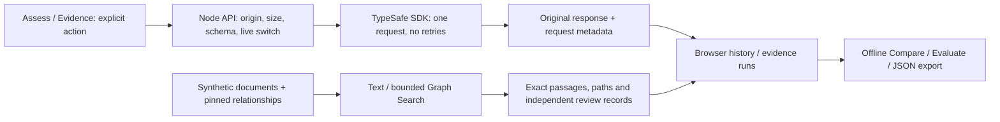

# Architecture and data flow

Jev Evaluation Lab is one Next.js App Router application. It has no application database, LLM, embedding service, graph database or general-purpose agent runtime. assistant-ui manages the assessment thread; it does not generate text or issue automatic inference requests.

## Boundaries

- `components/AssessmentWorkspace.tsx`: Assess, Compare, Evaluate, History and Evidence navigation, assistant-ui runtime, assessment history, explicit submission/cancellation.
- `components/QuestionEditor.tsx`: local question drafts, apply/reset and validated question JSON import/export. Applying never sends a request.
- `components/EvidenceExplorer.tsx`: scoped source inspection, Text/Graph selection, provenance and independent human evidence/relevance reviews.
- `components/EvidenceJudgments.tsx`: explicit six-case Jev actions, run persistence/import, configuration/model filters and reviewer agreement.
- `src/server/assessment-route.js`: shared bounded JSON parser, explicit live opt-in, origin guard, cancellation and sanitized provider errors. `/api/assess` and `/api/evidence` use it.
- `src/system-one.js`: server transport, server-only environment key, fixed provider endpoint, 30-second timeout, zero retries, SDK version, latency and unmodified parsed response.
- `src/question-config.js` and `examples/questions/`: shared, browser-safe configuration validation/defaults. `src/server/question-builders.js` creates native SDK Choice/Noul/Score questions. The technical CLI profile is unchanged.
- `src/ui/`: pure comparison/evaluation/review logic, browser persistence, graph/retrieval, evidence-run validation and agent-friendly import validation.
- `scripts/`: explicit CLI inference, offline validation/retrieval/audit replay, and a separately frozen live research protocol.

## Data ownership

Original requests and SDK responses are retained; numeric probabilities are never rounded in storage or exports. Human labels are separate records. Graph relationships include their source/derivation status; retrieval leads never become verified assertions automatically.

Assessments and evidence reviews/runs have separate versioned browser storage keys, each bounded. Older governance records without field reviews remain supported; only the independent project's storage keys and supported profiles are accepted. Storage is local to the browser and origin, not shared or backed up.

Imports validate before merging. Identical IDs are idempotent; conflicts are rejected rather than silently replacing reviews. Evidence imports attempt rollback on a storage failure and expose recovery errors. A browser cannot provide a durable multi-key database transaction; export important work. Exported derived statistics are not trusted on import.

Evidence classification summaries select the latest appended run per case after actual-model and exact configuration-content/version filters. Assessment evaluation exposes model/question-definition filters and labels unfiltered pooling. Comparing changed question definitions is descriptive, not equivalent-task evaluation.

## Documentation choice

Documentation uses repository Markdown. Sphinx was considered, but adds a Python environment and a documentation build without a current need for Python API generation, intersphinx or a large cross-referenced manual. Keep one source of documentation until those benefits justify another build.
