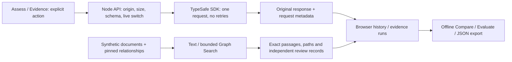

# Architecture and data flow

Jev Evaluation Lab is one Next.js App Router application. It has no application database, LLM, embedding service, graph database or general-purpose agent runtime. assistant-ui manages the assessment thread; it does not generate text or issue automatic inference requests.



## Boundaries

- `components/AssessmentWorkspace.tsx`: Analyze, Evidence, Documents and Evaluate navigation, with secondary Compare and History views, assistant-ui runtime, assessment history, explicit submission/cancellation.
- `components/QuestionEditor.tsx`: local question drafts, apply/reset and validated question JSON import/export. Applying never sends a request.
- `components/EvidenceExplorer.tsx`: scoped source inspection, an aligned Text/Graph comparison, provenance and independent human evidence/relevance reviews.
- `components/DocumentLibrary.tsx` and `components/SourceDocument.tsx`: the complete read-only corpus, revision-aware local references, section anchors and exact passage navigation.
- `components/LanguageProvider.tsx` and translation files: offline English/German display; stored originals and request wording remain independent of display language.
- `components/EvidenceJudgments.tsx`: explicit corpus-passage Jev actions, run persistence/import, configuration/model filters and reviewer agreement. Original six-case IDs and stored runs remain supported.
- `src/server/assessment-route.js`: shared bounded JSON parser, explicit live opt-in, origin guard, cancellation and sanitized provider errors. `/api/assess` and `/api/evidence` use it.
- `src/system-one.js`: server transport, server-only environment key, fixed provider endpoint, 30-second timeout, zero retries, SDK version, latency and unmodified parsed response.
- `src/question-config.js` and `examples/questions/`: shared, browser-safe configuration validation/defaults. `src/server/question-builders.js` creates native SDK Choice/Noul/Score questions. The technical CLI profile is unchanged.
- `src/ui/`: pure comparison/evaluation/review logic, browser persistence, graph/retrieval, evidence-run validation and agent-friendly import validation.
- `scripts/`: explicit CLI inference, offline validation/retrieval/audit replay, and a separately frozen live research protocol.

## Data ownership

Original requests and SDK responses are retained; numeric probabilities are never rounded in storage or exports. Human labels are separate records. Graph relationships include their source/derivation status; retrieval leads never become verified assertions automatically.

Assessments and evidence reviews/runs have separate versioned browser storage keys, each bounded. Older governance records without field reviews remain supported; only the independent project's storage keys and supported profiles are accepted. Storage is local to the browser and origin, not shared or backed up.

Imports validate before merging. Identical IDs are idempotent; conflicts are rejected rather than silently replacing reviews. Evidence imports attempt rollback on a storage failure and expose recovery errors. A browser cannot provide a durable multi-key database transaction; export important work. Exported derived statistics are not trusted on import.

Evidence classification summaries select the latest appended run per control/passage after actual-model and exact configuration-content/version filters. They distinguish missing predictions in the original six-case reference from additional corpus passages. Assessment evaluation exposes model/question-definition filters and labels unfiltered pooling. Comparing changed question definitions is descriptive, not equivalent-task evaluation.

## Documentation choice

Documentation uses repository Markdown. Sphinx was considered, but adds a Python environment and a documentation build without a current need for Python API generation, intersphinx or a large cross-referenced manual. Keep one source of documentation until those benefits justify another build.

## Regulatory demonstrator

`src/assessment/` validates versioned requirement/use-case definitions and evaluates
a small deterministic rule language. `src/regulatory/knowledge.ts` validates source
editions and exact citations. `src/ui/regulatory.ts` composes these with the existing
retrieval, evidence reviews, protected Jev requests, report exports and persistence.
`RegulatoryAssessment.tsx` renders the configured questions and requirements for
Claude Code and an internal assistant through the same guided workspace.
See [assessment configuration and migration](assessments.md). `/api/regulatory-evidence` reuses the protected inference handler and
server SDK transport. Frozen Human Oversight corpora are not extended or regenerated.
The versioned regulatory snapshot is independent, and original PDF files are optional
local ingestion inputs. See [the scope and demo guide](assessments.md).

## Jev integration and question configuration

The installed `@typesafe-ai/sdk` is 0.7.0. The transport calls `client.systemOne(request, { signal }).withResponse()` once with `retry: { maxRetries: 0 }`. This follows the [official JavaScript SDK](https://docs.typesafe.ai/sdk/javascript); question syntax is checked against the installed declarations as well as live responses.

`response` is the original parsed SDK data: actual model, typed answers, complete probability distributions and usage. The application adds request, SDK version, provider request ID, start time and latency outside it. A requested alias and the actual returned model are different metadata. Use a pinned model for experiments; aliases may move.

## Configurations

Default governance wording lives in `examples/questions/governance.json`; `src/governance.js` builds the same five questions using SDK primitives. Default evidence wording remains `src/evidence-question-config.js`, version `oversight-evidence-1`. Portable envelope examples also live in `examples/questions/`.

```json
{
  "schemaVersion": 1,
  "kind": "evidence",
  "version": "my-oversight-study-1",
  "questions": {
    "evidence_judgment": {"type": "choice", "instructions": "...", "criteria": {"supported": "...", "contradicted": "...", "insufficient_evidence": "...", "ambiguous": "..."}},
    "addresses_control": {"type": "noul", "instructions": "...", "criteria": {"true": "...", "false": "..."}}
  }
}
```

This illustrates structure; use a complete exported configuration for execution. Field IDs, types and category keys are fixed so existing reviews remain interpretable. Instructions and criteria are editable. Governance Score has four rubric levels, 0–3. Versions are 1–80 ASCII letters/digits/dots/underscores/hyphens. Instructions are limited to 2,000 characters; each criterion to 1,000; the whole configuration to 24,000 characters. Unknown fields, changed types, empty wording and incompatible keys are rejected server-side before inference. Edited content cannot reuse the built-in default version.

In Assess or Evidence, open **Edit … questions**, change the version/wording, then **Apply question configuration**. Imported JSON becomes a draft first. Apply/reset/import/export never call Jev. The next explicit Analyze/Judge action uses the applied snapshot. Drafts are session-local and reset on remount; saved results retain their executed configuration.

Version names alone do not establish equivalence. Evidence evaluation also compares the entire canonical configuration content, preventing different wording with the same custom version from silently pooling. Default old results remain valid without newly added metadata; exact executed request questions still have to match. Custom result envelopes retain `questionConfiguration` explicitly.

## Interpretation

Choice selects a category; Noul answers a statement; Score returns a fractional rubric position plus its distribution. Confidence concentration is not a verified correctness score. A high relevance Noul can be wrong: the live study's editorial distractor received 0.81/0.82. No Noul threshold changes the stored Choice judgment or creates a compliance verdict.

Relevant text can support, contradict or leave a control ambiguous. Missing documentation is not an explicit denial. A queue countersignature does not necessarily establish approval before execution. Retrieval relevance, evidence classification and legal compliance are separate questions.

The web accepts only server-selected cases/descriptions and narrowly validated question envelopes. Clients cannot provide keys, endpoint URLs, retries, arbitrary model routing or extra state. Keep `TYPESAFE_API_KEY` on the server. Hosted authentication and provider spend limits remain the operator's responsibility.
